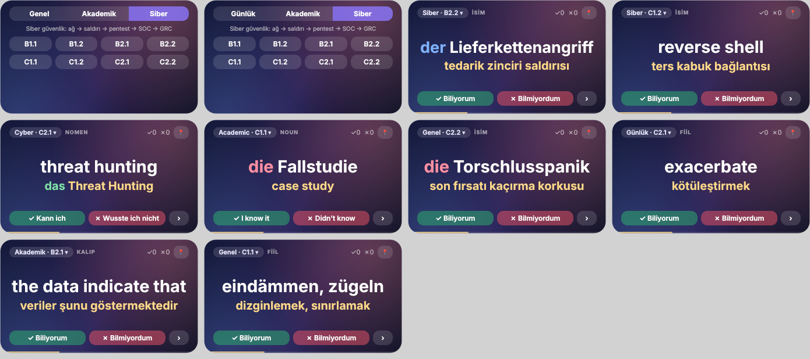

# Word Flow

**A tiny, always-on-top vocabulary widget.** Every 20 seconds it shows a new word, verb or phrase with its meaning right below it, so you pick up vocabulary whenever your eye lands on it.

[English](#english) · [Türkçe](#türkçe) · [Deutsch](#deutsch)



| Pair | Word → meaning | Modes (words) | UI language |
|---|---|---|---|
| `de-tr` | German → Turkish | General 2,588 · Academic 691 · Cyber 500 | Türkçe |
| `en-tr` | English → Turkish | Everyday 2,443 · Academic 753 · Cyber 502 | Türkçe |
| `en-de` | English → German | Everyday 2,443 · Academic 753 · Cyber 502 | Deutsch |
| `de-en` | German → English | General 2,588 · Academic 691 · Cyber 500 | English |

**Word lists**
- **General / Everyday (A1.1 – C2.2):** A1–B1 cover a 1,500-word core vocabulary (26 topics: greetings, numbers, family, home, food, city, work, official paperwork in Germany…) plus extra everyday verbs. B2–C1 add C1-level verbs, nouns, adjectives, phrasal verbs and connectors, sorted by word frequency. C2 adds rare words and idioms.
- **Academic (B1.1 – C2.2):** vocabulary and set phrases for papers, theses and talks (*the data indicate that…*, *beyond the scope of this study*).
- **Cyber (B1.1 – C2.2):** professional cybersecurity vocabulary as a curriculum: core concepts → networking → Linux/systems → attacks → web security → crypto & IAM → pentest/red team → SOC & incident response → GRC.
- Every word exists in Turkish, English and German, so all four pairs share the same content.

---

## English

### Features
- **A new card every 20 s** (10–60 s, change it from the right-click menu). A thin line at the bottom shows the time left.
- **The timer pauses while your mouse is over the card**, so you can read in peace.
- **✓ I know it**: the word comes back much less often. **✗ Didn't know**: it comes back more often and shows up again 4 cards later.
- **Levels A1.1 – C2.2** (12 steps). Most cards come from your level, with occasional review from lower ones.
- Three modes in every pair: **General/Everyday**, **Academic** and **Cyber**. Switch modes from the chip in the top-left corner.
- German articles are colour-coded: **der** in blue, **die** in pink, **das** in green. Verbs show their forms (*er fährt · ist gefahren*, *went · gone*).
- Drag the card anywhere, then 📍 lock its position. It stays always on top and you can set your own background image.
- Your progress is saved per pair in `~/.config/…`.

### Install (Linux)
```bash
sudo dnf install python3-pyqt6        # Fedora   (Debian/Ubuntu: sudo apt install python3-pyqt6)
git clone https://github.com/canyorg/word-flow.git
cd word-flow
./install.sh                          # adds 4 entries to the app menu
./install.sh --autostart de-tr en-tr  # optional: start these at login
```
Or run a pair directly: `python3 wordflow.py en-de`

**Windows:** `pip install PyQt6`, then `py wordflow.py de-en`

### Add your own words
The word lists live in `wordlists/german.py` and `wordlists/english.py`, one line per word:
```
type|word|Turkish meaning|hint
v|fahren|(araçla) gitmek|er fährt · ist gefahren
```
Then add the translation to the matching `DE_EN*` / `EN_DE*` table.

---

## Türkçe

Ekranın köşesinde duran küçük bir kelime kartı. Her 20 saniyede yeni bir kelime, fiil ya da kalıp gösteriyor ve anlamı hemen altında yazıyor. Gözün takıldığında öğreniyorsun.

- **✓ Biliyorum** dediğin kelime çok daha seyrek gelir. **✗ Bilmiyordum** dediğin daha sık gelir ve 4 kart sonra tekrar karşına çıkar.
- Fare kartın üstündeyken süre durur.
- Üç mod var:
  - **Genel/Günlük** (A1.1–C2.2): 1500 temel kelimeden başlayıp C1 kelimelerine ve C2 deyimlerine kadar gidiyor.
  - **Akademik**: makale, tez ve sunum dili.
  - **Siber Güvenlik**: ağ → saldırılar → pentest → SOC → GRC sırasıyla ilerliyor.
- Her kelimenin Türkçe, İngilizce ve Almanca karşılığı var. Dört dil çifti de aynı içeriği öğretiyor.
- Sağ tıkla süreyi, seviyeyi, arka plan resmini ve "her zaman üstte" ayarını değiştirebilirsin. 📍 kartın konumunu kilitler.

**Kurulum (Fedora):**
```bash
sudo dnf install python3-pyqt6
git clone https://github.com/canyorg/word-flow.git && cd word-flow
./install.sh --autostart de-tr en-tr
```

---

## Deutsch

Ein kleines Vokabel-Widget, das immer im Vordergrund bleibt. Alle 20 Sekunden erscheint ein neues Wort mit seiner Bedeutung direkt darunter.

- **✓ Kann ich**: Das Wort kommt seltener. **✗ Wusste ich nicht**: Es kommt öfter und erscheint nach 4 Karten erneut.
- Solange die Maus auf der Karte ist, hält der Timer an.
- Drei Modi: **Allgemein/Alltag** (A1.1 – C2.2), **Akademisch** und **Cyber** (Cybersecurity-Fachwortschatz).
- `en-de` (Englisch → Deutsch) hat eine deutsche Oberfläche, `de-en` eine englische.

```bash
sudo dnf install python3-pyqt6     # oder: pip install --user PyQt6
./install.sh --autostart en-de
```

---

Built with the help of Claude (vibe-coded). Word lists were compiled by hand; if you spot a wrong translation, please open an issue or a PR.

License: MIT
