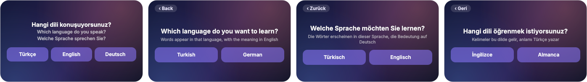
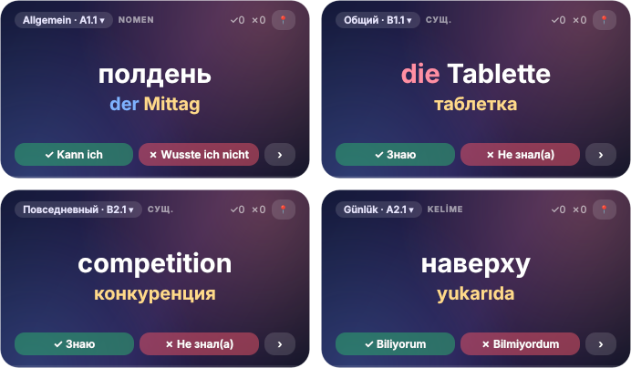
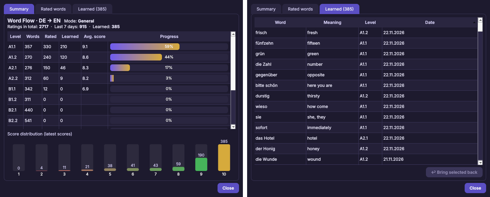
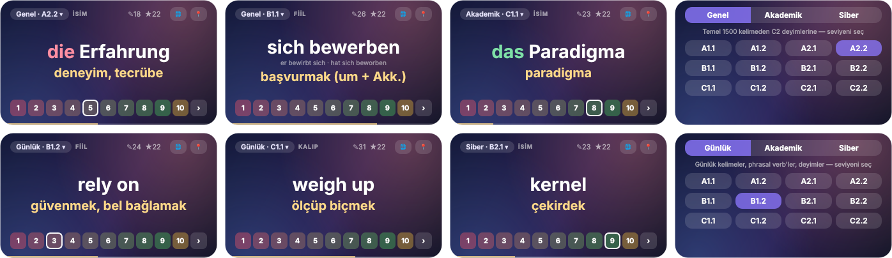
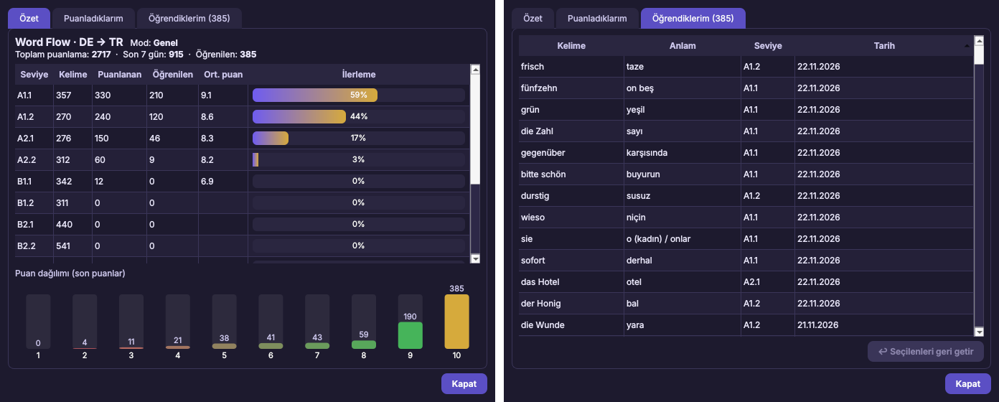
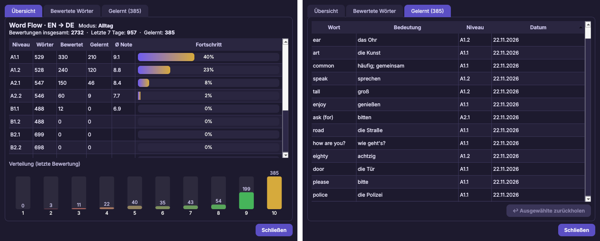
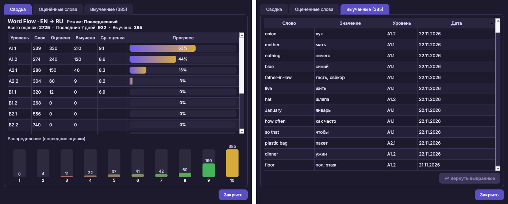

# Word Flow

**English** · [Türkçe](#türkçe) · [Deutsch](#deutsch) · [Русский](#русский)


## English

A tiny vocabulary widget that stays on top of your other windows. Every 20 seconds it shows a new word, verb or phrase with its meaning right below it, so you pick up vocabulary whenever your eye lands on it.

*Top row: English → German. Bottom row: German → English.*

### First start
Word Flow is a single app for English, German, Turkish and Russian. On first start it asks **which language you speak**, in all four languages. It then asks, in your language, **which of the other three you want to learn**, and finally which level you are at. You can change your languages at any time with the 🌐 button on the card.



| You speak | You learn | Word → meaning | Modes (number of words) |
|---|---|---|---|
| English | German | German → English | General 5,681 · Academic 691 · Cyber 500 |
| English | Turkish | Turkish → English | Everyday 6,691 · Academic 745 · Cyber 502 |
| German | English | English → German | Everyday 6,878 · Academic 753 · Cyber 502 |
| German | Turkish | Turkish → German | General 5,552 · Academic 684 · Cyber 500 |
| Turkish | English | English → Turkish | Everyday 6,878 · Academic 753 · Cyber 502 |
| Turkish | German | German → Turkish | General 5,681 · Academic 691 · Cyber 500 |
| Turkish | Russian | Russian → Turkish | Everyday 6,732 · Academic 746 · Cyber 502 |
| English | Russian | Russian → English | Everyday 6,732 · Academic 746 · Cyber 502 |
| German | Russian | Russian → German | General 5,517 · Academic 685 · Cyber 499 |
| Russian | English | English → Russian | Everyday 6,878 · Academic 753 · Cyber 502 |
| Russian | German | German → Russian | General 5,681 · Academic 691 · Cyber 500 |
| Russian | Turkish | Turkish → Russian | Everyday 6,691 · Academic 745 · Cyber 502 |



### Word lists
- **General / Everyday (A1.1 – C2.2).** Based on the official exam lists: German A1–B1 follow the **Goethe-Zertifikat word lists** (A1, A2, B1), English A1–C1 follow the **Oxford 3000 and Oxford 5000** with their CEFR levels. Every word of those lists is included at the level the list gives it, together with a core vocabulary of 1,500 words across 26 topics (greetings, numbers, family, home, food, the city, work, official paperwork in Germany). German B2–C2 and English C2 add advanced words, phrasal verbs, connectors and idioms, ordered by how common they are. Within a level, the more common half comes first (.1), the rest second (.2).
- **Academic (B1.1 – C2.2).** Vocabulary and set phrases for papers, theses and talks, such as *the data indicate that…* and *beyond the scope of this study*.
- **Cyber (B1.1 – C2.2).** Professional cybersecurity vocabulary, ordered like a course: core concepts → networking → Linux and systems → attacks → web security → cryptography and identity management → pentest and red team → SOC and incident response → governance, risk and compliance (GRC).
- Every word has a Turkish, English, German and Russian meaning, so every language combination teaches the same content.

### Features
- **A new card every 20 seconds.** You can choose 10–60 seconds from the right-click menu. A thin line at the bottom shows how much time is left.
- **The timer pauses while your mouse is over the card**, so you can read in peace.
- **Rate every word from 1 to 10** with the buttons on the card: 1 = never seen it, 5 = know it but not the article, 9 = almost. The score is only a record: words come up **at random**, and a 1 or a 9 doesn't change how often a word is shown.
- **10 = I know it.** The word moves to your *Learned* list and isn't shown again. Clicked 10 by mistake? Open the report and bring it back.
- **Report** (right-click → 📊 Report): progress per level, your score distribution, every word you rated with its full score history, and the *Learned* list.
- **Hide the meaning** (right-click → Hide the meaning): the card first shows only the word, so you try to recall it yourself. The meaning appears after 3, 5 or 8 seconds, or only when you hover over or click the card.
- **🔊 Read aloud:** the 🔊 button on the card reads the word aloud, and you can turn on automatic reading for every new word. It works offline with your system's voices. On Linux, if there is no voice for a language: `sudo dnf install espeak-ng`.
- **12 levels from A1.1 to C2.2.** Most cards come from your level, with an occasional review word from lower levels.
- **Three modes:** General/Everyday, Academic and Cyber. To switch, click the chip in the top-left corner.
- **German articles are colour-coded:** *der* is blue, *die* is pink and *das* is green. Verbs show their forms (*er fährt · ist gefahren*, *went · gone*).
- You can drag the card anywhere and 📍 lock it in place. It stays on top of other windows, and you can set your own background image.
- Your progress is saved separately for each language combination in `~/.config/…`.



### Windows
Download **[WordFlow.exe](https://github.com/canyorg/word-flow/releases/latest/download/WordFlow.exe)** and double-click it. That's all: there is nothing to install and no Python needed. To start it automatically, right-click the card and tick **Start with Windows**.

Windows may show a blue "Windows protected your PC" box the first time, because the exe isn't signed. Click **More info → Run anyway**.

### Installation (Linux)
```bash
sudo dnf install python3-pyqt6   # Fedora  (Debian/Ubuntu: sudo apt install python3-pyqt6)
git clone https://github.com/canyorg/word-flow.git
cd word-flow
./install.sh --autostart         # adds "Word Flow" to the app menu and starts it at login
```
Or run it without installing: `python3 wordflow.py`

**Windows from source:** `pip install PyQt6`, then `py wordflow.py`

To update later: `git pull && ./install.sh`

### Adding your own words
The word lists are in `wordlists/german.py` and `wordlists/english.py`, one line per word:
```
type|word|Turkish meaning|hint
v|fahren|(araçla) gitmek|er fährt · ist gefahren
```
Then add the translation to the matching `DE_EN*` or `EN_DE*` table, and the Russian one to `EN_RU` or `DE_RU` in `wordlists/russian.py`.

---

## Türkçe

Diğer pencerelerin üstünde duran küçük bir kelime widget'ı. Her 20 saniyede yeni bir kelime, fiil ya da kalıp gösteriyor ve anlamı hemen altında yazıyor. Böylece gözün takıldığında öğreniyorsun.



*Üst sıra: Almanca → Türkçe. Alt sıra: İngilizce → Türkçe. İngilizce ↔ Almanca görüntüleri sayfanın en üstünde.*

### İlk açılış
Word Flow İngilizce, Almanca, Türkçe ve Rusça için tek bir uygulama. İlk açılışta dört dilde birden **hangi dili konuştuğunu** soruyor. Ardından seçtiğin dilde **diğer üç dilden hangisini öğrenmek istediğini**, en son da seviyeni soruyor. Dillerini kartın üstündeki 🌐 düğmesiyle istediğin zaman değiştirebilirsin.


| Konuştuğun dil | Öğrendiğin dil | Kelime → anlamı | Modlar (kelime sayısı) |
|---|---|---|---|
| Türkçe | İngilizce | İngilizce → Türkçe | Günlük 6.878 · Akademik 753 · Siber 502 |
| Türkçe | Almanca | Almanca → Türkçe | Genel 5.681 · Akademik 691 · Siber 500 |
| İngilizce | Almanca | Almanca → İngilizce | Genel 5.681 · Akademik 691 · Siber 500 |
| İngilizce | Türkçe | Türkçe → İngilizce | Günlük 6.691 · Akademik 745 · Siber 502 |
| Almanca | İngilizce | İngilizce → Almanca | Günlük 6.878 · Akademik 753 · Siber 502 |
| Almanca | Türkçe | Türkçe → Almanca | Genel 5.552 · Akademik 684 · Siber 500 |
| Türkçe | Rusça | Rusça → Türkçe | Günlük 6.732 · Akademik 746 · Siber 502 |
| İngilizce | Rusça | Rusça → İngilizce | Günlük 6.732 · Akademik 746 · Siber 502 |
| Almanca | Rusça | Rusça → Almanca | Genel 5.517 · Akademik 685 · Siber 499 |
| Rusça | İngilizce | İngilizce → Rusça | Günlük 6.878 · Akademik 753 · Siber 502 |
| Rusça | Almanca | Almanca → Rusça | Genel 5.681 · Akademik 691 · Siber 500 |
| Rusça | Türkçe | Türkçe → Rusça | Günlük 6.691 · Akademik 745 · Siber 502 |

### Kelime listeleri
- **Genel / Günlük (A1.1 – C2.2).** Resmî sınav listelerine dayanıyor: Almanca A1–B1 **Goethe-Zertifikat kelime listelerini** (A1, A2, B1), İngilizce A1–C1 ise CEFR seviyeleriyle **Oxford 3000 ve Oxford 5000** listelerini izliyor. Bu listelerdeki her kelime, listenin verdiği seviyede yer alıyor. Bunlara 26 konuda 1500 temel kelime eklendi (selamlaşma, sayılar, aile, ev, yemek, şehir, iş, Almanya'daki resmî işler). Almanca B2–C2 ve İngilizce C2'de ileri düzey kelimeler, phrasal verb'ler, bağlaçlar ve deyimler var; ne kadar sık kullanıldıklarına göre sıralandılar. Her seviyede daha sık kullanılan yarı önce (.1), kalanı sonra (.2) geliyor.
- **Akademik (B1.1 – C2.2).** Makale, tez ve sunum dili için kelimeler ve kalıplar. Örneğin *the data indicate that…* ve *beyond the scope of this study*.
- **Siber Güvenlik (B1.1 – C2.2).** Mesleki siber güvenlik terimleri bir ders gibi sıralandı: temel kavramlar → ağ → Linux ve sistemler → saldırılar → web güvenliği → kriptografi ve kimlik yönetimi → sızma testi ve kırmızı takım → SOC ve olay müdahalesi → yönetişim, risk ve uyum (GRC).
- Her kelimenin Türkçe, İngilizce, Almanca ve Rusça karşılığı var. Hangi dil kombinasyonunu seçersen seç, içerik aynı.

### Özellikler
- **Her 20 saniyede yeni kart.** Sağ tık menüsünden 10–60 saniye arasında bir süre seçebilirsin. Alttaki ince çizgi kalan süreyi gösteriyor.
- **Fare kartın üstündeyken süre duruyor**, yani rahatça okuyabiliyorsun.
- **Her kelimeye 1–10 arası puan ver.** 1 = hiç görmedim, 5 = biliyorum ama artikelini bilmiyorum, 9 = neredeyse. Puan sadece kayıt içindir: kelimeler **rastgele** gelir, 1 ya da 9 vermen gösterilme sıklığını değiştirmez.
- **10 = tam biliyorum.** Kelime *Öğrendiklerim* listesine geçer ve bir daha gösterilmez. Yanlışlıkla 10'a bastıysan rapordan geri getirebilirsin.
- **Rapor** (sağ tık → 📊 Rapor): seviye başına ilerleme, puan dağılımı, puanladığın her kelime ve tüm puan geçmişi, ayrıca *Öğrendiklerim* listesi.
- **Anlamı gizle** (sağ tık → Anlamı gizle): kart önce sadece kelimeyi gösterir, sen hatırlamaya çalışırsın. Anlam 3, 5 ya da 8 saniye sonra veya sadece kartın üzerine gelince ya da tıklayınca açılır.
- **🔊 Sesli okuma:** karttaki 🔊 butonu kelimeyi sesli okur, istersen her yeni kelime otomatik okunur. İnternetsiz çalışır, sistemin kendi seslerini kullanır. Linux'ta bir dil için ses yoksa: `sudo dnf install espeak-ng`.
- **A1.1'den C2.2'ye 12 seviye.** Kartların çoğu senin seviyenden gelir, ara sıra alt seviyelerden tekrar kelimesi de çıkar.
- **Üç mod:** Genel/Günlük, Akademik ve Siber. Geçiş yapmak için sol üstteki etikete tıkla.
- **Almanca artikeller renkli:** *der* mavi, *die* pembe, *das* yeşil. Fiillerin altında çekimleri görünür (*er fährt · ist gefahren*, *went · gone*).
- Kartı istediğin yere sürükleyip 📍 ile sabitleyebilirsin. Diğer pencerelerin üstünde kalır ve istersen kendi arka plan resmini seçebilirsin.
- İlerlemen her dil kombinasyonu için ayrı olarak `~/.config/…` içinde saklanır.



### Windows
**[WordFlow.exe](https://github.com/canyorg/word-flow/releases/latest/download/WordFlow.exe)** dosyasını indir ve çift tıkla. Bu kadar: kurulum yok, Python gerekmiyor. Bilgisayar açılınca kendiliğinden başlasın istersen karta sağ tıklayıp **Windows ile başlat** seçeneğini işaretle.

İlk açılışta Windows mavi bir "Windows bilgisayarınızı korudu" penceresi gösterebilir, çünkü exe imzalı değil. **Ek bilgi → Yine de çalıştır**'a tıkla.

### Kurulum (Linux)
```bash
sudo dnf install python3-pyqt6   # Fedora  (Debian/Ubuntu: sudo apt install python3-pyqt6)
git clone https://github.com/canyorg/word-flow.git
cd word-flow
./install.sh --autostart         # "Word Flow"u uygulama menüsüne ekler, oturum açılınca başlatır
```
Kurmadan da çalıştırabilirsin: `python3 wordflow.py`

**Windows'ta kaynak koddan:** `pip install PyQt6`, ardından `py wordflow.py`

İleride güncellemek için: `git pull && ./install.sh`

### Kendi kelimelerini eklemek
Kelime listeleri `wordlists/german.py` ve `wordlists/english.py` dosyalarında, her satırda bir kelime:
```
tür|kelime|Türkçe anlamı|ipucu
v|fahren|(araçla) gitmek|er fährt · ist gefahren
```
Sonra çevirisini ilgili `DE_EN*` ya da `EN_DE*` tablosuna, Rusçasını da `wordlists/russian.py` içindeki `EN_RU` ya da `DE_RU` tablosuna ekle.

---

## Deutsch

Ein kleines Vokabel-Widget, das über deinen anderen Fenstern bleibt. Alle 20 Sekunden zeigt es ein neues Wort, Verb oder eine Wendung mit der Bedeutung direkt darunter. So lernst du Vokabeln immer dann, wenn dein Blick darauf fällt.


*Obere Reihe: Englisch → Deutsch. Untere Reihe: Deutsch → Englisch.*

### Erster Start
Word Flow ist eine einzige App für Englisch, Deutsch, Türkisch und Russisch. Beim ersten Start fragt sie in allen vier Sprachen, **welche Sprache du sprichst**. Danach fragt sie in deiner Sprache, **welche der drei anderen du lernen möchtest**, und zuletzt nach deinem Niveau. Mit der 🌐-Schaltfläche auf der Karte kannst du deine Sprachen jederzeit ändern.


| Du sprichst | Du lernst | Wort → Bedeutung | Modi (Anzahl Wörter) |
|---|---|---|---|
| Deutsch | Englisch | Englisch → Deutsch | Alltag 6.878 · Akademisch 753 · Cyber 502 |
| Deutsch | Türkisch | Türkisch → Deutsch | Allgemein 5.552 · Akademisch 684 · Cyber 500 |
| Englisch | Deutsch | Deutsch → Englisch | Allgemein 5.681 · Akademisch 691 · Cyber 500 |
| Englisch | Türkisch | Türkisch → Englisch | Alltag 6.691 · Akademisch 745 · Cyber 502 |
| Türkisch | Englisch | Englisch → Türkisch | Alltag 6.878 · Akademisch 753 · Cyber 502 |
| Türkisch | Deutsch | Deutsch → Türkisch | Allgemein 5.681 · Akademisch 691 · Cyber 500 |
| Deutsch | Russisch | Russisch → Deutsch | Allgemein 5.517 · Akademisch 685 · Cyber 499 |
| Englisch | Russisch | Russisch → Englisch | Alltag 6.732 · Akademisch 746 · Cyber 502 |
| Türkisch | Russisch | Russisch → Türkisch | Alltag 6.732 · Akademisch 746 · Cyber 502 |
| Russisch | Deutsch | Deutsch → Russisch | Allgemein 5.681 · Akademisch 691 · Cyber 500 |
| Russisch | Englisch | Englisch → Russisch | Alltag 6.878 · Akademisch 753 · Cyber 502 |
| Russisch | Türkisch | Türkisch → Russisch | Alltag 6.691 · Akademisch 745 · Cyber 502 |

### Wortlisten
- **Allgemein / Alltag (A1.1 – C2.2).** Grundlage sind die offiziellen Prüfungslisten: Deutsch A1–B1 folgt den **Wortlisten des Goethe-Zertifikats** (A1, A2, B1), Englisch A1–C1 der **Oxford 3000 und Oxford 5000** mit ihren GER-Niveaus. Jedes Wort dieser Listen ist auf dem dort angegebenen Niveau enthalten, dazu ein Grundwortschatz von 1.500 Wörtern aus 26 Themen (Begrüßung, Zahlen, Familie, Wohnen, Essen, Stadt, Arbeit, Behördengänge in Deutschland). Deutsch B2–C2 und Englisch C2 ergänzen fortgeschrittene Wörter, Phrasal Verbs, Konnektoren und Redewendungen, sortiert nach Häufigkeit. Innerhalb eines Niveaus kommt die häufigere Hälfte zuerst (.1), der Rest danach (.2).
- **Akademisch (B1.1 – C2.2).** Wortschatz und feste Wendungen für Paper, Abschlussarbeiten und Vorträge, zum Beispiel *the data indicate that…* und *beyond the scope of this study*.
- **Cyber (B1.1 – C2.2).** Fachwortschatz der Cybersecurity, aufgebaut wie ein Kurs: Grundbegriffe → Netzwerke → Linux und Systeme → Angriffe → Websicherheit → Kryptografie und Identitätsmanagement → Pentest und Red Team → SOC und Incident Response → Governance, Risiko und Compliance (GRC).
- Jedes Wort hat eine türkische, englische, deutsche und russische Bedeutung, daher vermittelt jede Sprachkombination denselben Inhalt.

### Funktionen
- **Alle 20 Sekunden eine neue Karte.** Im Rechtsklickmenü kannst du 10–60 Sekunden einstellen. Eine dünne Linie unten zeigt die verbleibende Zeit.
- **Solange die Maus auf der Karte ist, hält der Timer an**, damit du in Ruhe lesen kannst.
- **Jedes Wort von 1 bis 10 bewerten.** 1 = nie gesehen, 5 = kenne es, aber nicht den Artikel, 9 = fast. Die Note wird nur aufgezeichnet: Wörter kommen **zufällig**, eine 1 oder 9 ändert nicht, wie oft ein Wort erscheint.
- **10 = kann ich.** Das Wort wandert in die Liste *Gelernt* und wird nicht mehr gezeigt. Aus Versehen 10 geklickt? Im Bericht zurückholen.
- **Bericht** (Rechtsklick → 📊 Bericht): Fortschritt pro Niveau, Notenverteilung, alle bewerteten Wörter mit ihrem Verlauf und die Liste *Gelernt*.
- **Bedeutung verbergen** (Rechtsklick → Bedeutung verbergen): Die Karte zeigt zuerst nur das Wort, damit du dich selbst erinnerst. Die Bedeutung erscheint nach 3, 5 oder 8 Sekunden oder nur beim Überfahren bzw. Klicken.
- **🔊 Vorlesen:** Der 🔊-Knopf liest das Wort vor, auf Wunsch jedes neue Wort automatisch. Funktioniert offline mit den Stimmen deines Systems. Unter Linux, falls für eine Sprache keine Stimme da ist: `sudo dnf install espeak-ng`.
- **12 Niveaus von A1.1 bis C2.2.** Die meisten Karten kommen aus deinem Niveau, ab und zu kommt ein Wiederholungswort aus einem niedrigeren.
- **Drei Modi:** Allgemein/Alltag, Akademisch und Cyber. Zum Wechseln auf das Feld oben links klicken.
- **Deutsche Artikel sind farbig:** *der* blau, *die* rosa, *das* grün. Verben zeigen ihre Formen (*er fährt · ist gefahren*, *went · gone*).
- Du kannst die Karte überallhin ziehen und mit 📍 fixieren. Sie bleibt über anderen Fenstern, und du kannst ein eigenes Hintergrundbild wählen.
- Dein Fortschritt wird für jede Sprachkombination getrennt in `~/.config/…` gespeichert.



### Windows
**[WordFlow.exe](https://github.com/canyorg/word-flow/releases/latest/download/WordFlow.exe)** herunterladen und doppelklicken. Fertig: keine Installation, kein Python nötig. Damit es automatisch startet, Rechtsklick auf die Karte und **Mit Windows starten** anhaken.

Beim ersten Start zeigt Windows eventuell ein blaues Fenster „Der Computer wurde durch Windows geschützt“, weil die exe nicht signiert ist. Auf **Weitere Informationen → Trotzdem ausführen** klicken.

### Installation (Linux)
```bash
sudo dnf install python3-pyqt6   # Fedora  (Debian/Ubuntu: sudo apt install python3-pyqt6)
git clone https://github.com/canyorg/word-flow.git
cd word-flow
./install.sh --autostart         # fügt "Word Flow" dem App-Menü hinzu und startet es beim Anmelden
```
Oder ohne Installation starten: `python3 wordflow.py`

**Windows aus dem Quellcode:** `pip install PyQt6`, dann `py wordflow.py`

Später aktualisieren: `git pull && ./install.sh`

### Eigene Wörter hinzufügen
Die Wortlisten stehen in `wordlists/german.py` und `wordlists/english.py`, ein Wort pro Zeile:
```
Typ|Wort|türkische Bedeutung|Hinweis
v|fahren|(araçla) gitmek|er fährt · ist gefahren
```
Danach die Übersetzung in die passende Tabelle `DE_EN*` oder `EN_DE*` eintragen, die russische in `EN_RU` oder `DE_RU` in `wordlists/russian.py`.

---

## Русский

Маленький виджет для изучения слов, который всегда остаётся поверх других окон. Каждые 20 секунд он показывает новое слово, глагол или выражение, а прямо под ним — значение. Так слова запоминаются каждый раз, когда на них падает взгляд.


### Первый запуск
Word Flow — одно приложение для английского, немецкого, турецкого и русского. При первом запуске оно на всех четырёх языках спрашивает, **на каком языке вы говорите**, затем на вашем языке — **какой из трёх других вы хотите учить**, и в конце — ваш уровень. Языки можно сменить в любой момент кнопкой 🌐 на карточке.

| Вы говорите | Вы учите | Слово → значение | Режимы (количество слов) |
|---|---|---|---|
| русский | английский | английский → русский | Повседневный 6 878 · Академический 753 · Кибер 502 |
| русский | немецкий | немецкий → русский | Общий 5 681 · Академический 691 · Кибер 500 |
| русский | турецкий | турецкий → русский | Повседневный 6 691 · Академический 745 · Кибер 502 |
| английский | русский | русский → английский | 6 732 · 746 · 502 |
| немецкий | русский | русский → немецкий | 5 517 · 685 · 499 |
| турецкий | русский | русский → турецкий | 6 732 · 746 · 502 |

**Windows:** скачайте **[WordFlow.exe](https://github.com/canyorg/word-flow/releases/latest/download/WordFlow.exe)** и запустите двойным щелчком — ничего устанавливать не нужно. Автозапуск: правый клик по карточке → **Запускать вместе с Windows**. Если появится окно «Windows защитила ваш компьютер», нажмите **Подробнее → Выполнить в любом случае**.

**Скрывать значение** (правый клик → Скрывать значение): сначала видно только слово, значение появляется через 3, 5 или 8 секунд либо при наведении/щелчке. **🔊** читает слово вслух (офлайн, системными голосами; в Linux при отсутствии голоса: `sudo dnf install espeak-ng`).

Списки слов основаны на официальных экзаменационных списках: немецкий A1–B1 — **Goethe-Zertifikat**, английский A1–C1 — **Oxford 3000 / 5000**.

Всё остальное (уровни A1.1–C2.2, оценка каждого слова от 1 до 10 — слова показываются случайно, а 10 = «знаю», слово больше не показывается и его можно вернуть в отчёте (правый клик → 📊 Отчёт), три режима, установка) работает так же, как описано выше.



---

Built with the help of Claude (vibe-coded). The word lists were compiled by hand; if you spot a wrong translation, please open an issue or a pull request.

License: MIT
