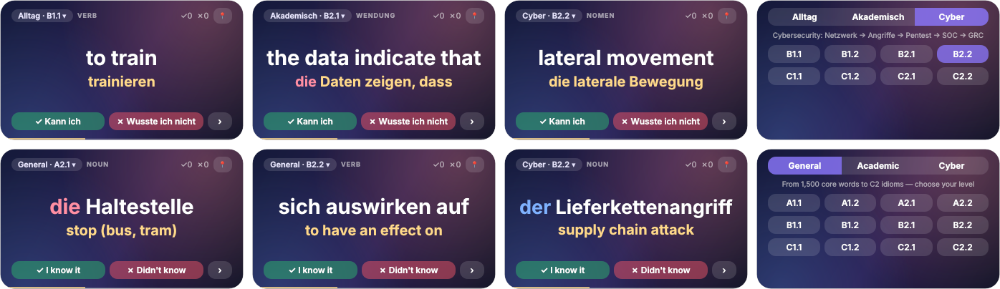

# Word Flow

**English** · [Türkçe](#türkçe) · [Deutsch](#deutsch)



## English

A tiny vocabulary widget that stays on top of your other windows. Every 20 seconds it shows a new word, verb or phrase with its meaning right below it, so you pick up vocabulary whenever your eye lands on it.

*Top row: English → German. Bottom row: German → English.*

### Language pairs

| Pair | Word → meaning | Modes (number of words) | Interface |
|---|---|---|---|
| `en-de` | English → German | Everyday 2,443 · Academic 753 · Cyber 502 | German |
| `de-en` | German → English | General 2,588 · Academic 691 · Cyber 500 | English |
| `de-tr` | German → Turkish | General 2,588 · Academic 691 · Cyber 500 | Turkish |
| `en-tr` | English → Turkish | Everyday 2,443 · Academic 753 · Cyber 502 | Turkish |

### Word lists
- **General / Everyday (A1.1 – C2.2).** A1–B1 cover a core vocabulary of 1,500 words across 26 topics, such as greetings, numbers, family, home, food, the city, work and official paperwork in Germany. Extra everyday verbs are included too. B2–C1 add C1-level verbs, nouns, adjectives, phrasal verbs and connectors, ordered by how common they are. C2 adds rare words and idioms.
- **Academic (B1.1 – C2.2).** Vocabulary and set phrases for papers, theses and talks, such as *the data indicate that…* and *beyond the scope of this study*.
- **Cyber (B1.1 – C2.2).** Professional cybersecurity vocabulary, ordered like a course: core concepts → networking → Linux and systems → attacks → web security → cryptography and identity management → pentest and red team → SOC and incident response → governance, risk and compliance (GRC).
- Every word has a Turkish, English and German meaning, so all four pairs teach the same content.

### Features
- **A new card every 20 seconds.** You can choose 10–60 seconds from the right-click menu. A thin line at the bottom shows how much time is left.
- **The timer pauses while your mouse is over the card**, so you can read in peace.
- **✓ I know it**: the word comes back much less often. **✗ Didn't know**: the word comes back more often and shows up again 4 cards later.
- **12 levels from A1.1 to C2.2.** Most cards come from your level, with an occasional review word from lower levels.
- **Three modes in every pair:** General/Everyday, Academic and Cyber. To switch, click the chip in the top-left corner.
- **German articles are colour-coded:** *der* is blue, *die* is pink and *das* is green. Verbs show their forms (*er fährt · ist gefahren*, *went · gone*).
- You can drag the card anywhere and 📍 lock it in place. It stays on top of other windows, and you can set your own background image.
- Your progress is saved separately for each pair in `~/.config/…`.

### Installation (Linux)
```bash
sudo dnf install python3-pyqt6        # Fedora  (Debian/Ubuntu: sudo apt install python3-pyqt6)
git clone https://github.com/canyorg/word-flow.git
cd word-flow
./install.sh                          # adds the 4 pairs to the app menu
./install.sh --autostart en-de de-en  # optional: start these pairs at login
```
You can also run a pair directly, for example `python3 wordflow.py en-de`.

**Windows:** `pip install PyQt6`, then `py wordflow.py en-de`

### Adding your own words
The word lists are in `wordlists/german.py` and `wordlists/english.py`, one line per word:
```
type|word|Turkish meaning|hint
v|fahren|(araçla) gitmek|er fährt · ist gefahren
```
Then add the translation to the matching `DE_EN*` or `EN_DE*` table.

---

## Türkçe

Diğer pencerelerin üstünde duran küçük bir kelime widget'ı. Her 20 saniyede yeni bir kelime, fiil ya da kalıp gösteriyor ve anlamı hemen altında yazıyor. Böylece gözün takıldığında öğreniyorsun.


*Üst sıra: Almanca → Türkçe. Alt sıra: İngilizce → Türkçe. İngilizce ↔ Almanca görüntüleri sayfanın en üstünde.*

### Dil çiftleri

| Çift | Kelime → anlamı | Modlar (kelime sayısı) | Arayüz |
|---|---|---|---|
| `en-de` | İngilizce → Almanca | Günlük 2.443 · Akademik 753 · Siber 502 | Almanca |
| `de-en` | Almanca → İngilizce | Genel 2.588 · Akademik 691 · Siber 500 | İngilizce |
| `de-tr` | Almanca → Türkçe | Genel 2.588 · Akademik 691 · Siber 500 | Türkçe |
| `en-tr` | İngilizce → Türkçe | Günlük 2.443 · Akademik 753 · Siber 502 | Türkçe |

### Kelime listeleri
- **Genel / Günlük (A1.1 – C2.2).** A1–B1 seviyeleri 26 konuda 1500 temel kelimeyi kapsıyor. Konular arasında selamlaşma, sayılar, aile, ev, yemek, şehir, iş ve Almanya'daki resmî işler var. Bunlara ek günlük fiiller de eklendi. B2–C1 seviyelerinde C1 düzeyinde fiiller, isimler, sıfatlar, phrasal verb'ler ve bağlaçlar var; ne kadar sık kullanıldıklarına göre sıralandılar. C2'de nadir kelimeler ve deyimler var.
- **Akademik (B1.1 – C2.2).** Makale, tez ve sunum dili için kelimeler ve kalıplar. Örneğin *the data indicate that…* ve *beyond the scope of this study*.
- **Siber Güvenlik (B1.1 – C2.2).** Mesleki siber güvenlik terimleri bir ders gibi sıralandı: temel kavramlar → ağ → Linux ve sistemler → saldırılar → web güvenliği → kriptografi ve kimlik yönetimi → sızma testi ve kırmızı takım → SOC ve olay müdahalesi → yönetişim, risk ve uyum (GRC).
- Her kelimenin Türkçe, İngilizce ve Almanca karşılığı var. Dört dil çifti de aynı içeriği öğretiyor.

### Özellikler
- **Her 20 saniyede yeni kart.** Sağ tık menüsünden 10–60 saniye arasında bir süre seçebilirsin. Alttaki ince çizgi kalan süreyi gösteriyor.
- **Fare kartın üstündeyken süre duruyor**, yani rahatça okuyabiliyorsun.
- **✓ Biliyorum** dediğin kelime çok daha seyrek gelir. **✗ Bilmiyordum** dediğin kelime daha sık gelir ve 4 kart sonra tekrar karşına çıkar.
- **A1.1'den C2.2'ye 12 seviye.** Kartların çoğu senin seviyenden gelir, ara sıra alt seviyelerden tekrar kelimesi de çıkar.
- **Her çiftte üç mod var:** Genel/Günlük, Akademik ve Siber. Geçiş yapmak için sol üstteki etikete tıkla.
- **Almanca artikeller renkli:** *der* mavi, *die* pembe, *das* yeşil. Fiillerin altında çekimleri görünür (*er fährt · ist gefahren*, *went · gone*).
- Kartı istediğin yere sürükleyip 📍 ile sabitleyebilirsin. Diğer pencerelerin üstünde kalır ve istersen kendi arka plan resmini seçebilirsin.
- İlerlemen her dil çifti için ayrı olarak `~/.config/…` içinde saklanır.

### Kurulum (Linux)
```bash
sudo dnf install python3-pyqt6        # Fedora  (Debian/Ubuntu: sudo apt install python3-pyqt6)
git clone https://github.com/canyorg/word-flow.git
cd word-flow
./install.sh                          # 4 dil çiftini uygulama menüsüne ekler
./install.sh --autostart de-tr en-tr  # isteğe bağlı: bu çiftler oturum açılınca başlar
```
Bir çifti doğrudan da çalıştırabilirsin, örneğin `python3 wordflow.py de-tr`.

**Windows:** `pip install PyQt6`, ardından `py wordflow.py de-tr`

### Kendi kelimelerini eklemek
Kelime listeleri `wordlists/german.py` ve `wordlists/english.py` dosyalarında, her satırda bir kelime:
```
tür|kelime|Türkçe anlamı|ipucu
v|fahren|(araçla) gitmek|er fährt · ist gefahren
```
Sonra çevirisini ilgili `DE_EN*` ya da `EN_DE*` tablosuna ekle.

---

## Deutsch

Ein kleines Vokabel-Widget, das über deinen anderen Fenstern bleibt. Alle 20 Sekunden zeigt es ein neues Wort, Verb oder eine Wendung mit der Bedeutung direkt darunter. So lernst du Vokabeln immer dann, wenn dein Blick darauf fällt.


*Obere Reihe: Englisch → Deutsch. Untere Reihe: Deutsch → Englisch.*

### Sprachpaare

| Paar | Wort → Bedeutung | Modi (Anzahl Wörter) | Oberfläche |
|---|---|---|---|
| `en-de` | Englisch → Deutsch | Alltag 2.443 · Akademisch 753 · Cyber 502 | Deutsch |
| `de-en` | Deutsch → Englisch | Allgemein 2.588 · Akademisch 691 · Cyber 500 | Englisch |
| `de-tr` | Deutsch → Türkisch | Allgemein 2.588 · Akademisch 691 · Cyber 500 | Türkisch |
| `en-tr` | Englisch → Türkisch | Alltag 2.443 · Akademisch 753 · Cyber 502 | Türkisch |

### Wortlisten
- **Allgemein / Alltag (A1.1 – C2.2).** A1–B1 umfassen einen Grundwortschatz von 1.500 Wörtern aus 26 Themen, zum Beispiel Begrüßung, Zahlen, Familie, Wohnen, Essen, Stadt, Arbeit und Behördengänge in Deutschland. Dazu kommen weitere Alltagsverben. B2–C1 ergänzen Verben, Nomen, Adjektive, Phrasal Verbs und Konnektoren auf C1-Niveau, sortiert nach Häufigkeit. C2 enthält seltene Wörter und Redewendungen.
- **Akademisch (B1.1 – C2.2).** Wortschatz und feste Wendungen für Paper, Abschlussarbeiten und Vorträge, zum Beispiel *the data indicate that…* und *beyond the scope of this study*.
- **Cyber (B1.1 – C2.2).** Fachwortschatz der Cybersecurity, aufgebaut wie ein Kurs: Grundbegriffe → Netzwerke → Linux und Systeme → Angriffe → Websicherheit → Kryptografie und Identitätsmanagement → Pentest und Red Team → SOC und Incident Response → Governance, Risiko und Compliance (GRC).
- Jedes Wort hat eine türkische, englische und deutsche Bedeutung, daher vermitteln alle vier Paare denselben Inhalt.

### Funktionen
- **Alle 20 Sekunden eine neue Karte.** Im Rechtsklickmenü kannst du 10–60 Sekunden einstellen. Eine dünne Linie unten zeigt die verbleibende Zeit.
- **Solange die Maus auf der Karte ist, hält der Timer an**, damit du in Ruhe lesen kannst.
- **✓ Kann ich**: Das Wort kommt deutlich seltener. **✗ Wusste ich nicht**: Das Wort kommt öfter und erscheint nach 4 Karten erneut.
- **12 Niveaus von A1.1 bis C2.2.** Die meisten Karten kommen aus deinem Niveau, ab und zu kommt ein Wiederholungswort aus einem niedrigeren.
- **Drei Modi in jedem Paar:** Allgemein/Alltag, Akademisch und Cyber. Zum Wechseln auf das Feld oben links klicken.
- **Deutsche Artikel sind farbig:** *der* blau, *die* rosa, *das* grün. Verben zeigen ihre Formen (*er fährt · ist gefahren*, *went · gone*).
- Du kannst die Karte überallhin ziehen und mit 📍 fixieren. Sie bleibt über anderen Fenstern, und du kannst ein eigenes Hintergrundbild wählen.
- Dein Fortschritt wird für jedes Paar getrennt in `~/.config/…` gespeichert.

### Installation (Linux)
```bash
sudo dnf install python3-pyqt6        # Fedora  (Debian/Ubuntu: sudo apt install python3-pyqt6)
git clone https://github.com/canyorg/word-flow.git
cd word-flow
./install.sh                          # fügt die 4 Paare dem App-Menü hinzu
./install.sh --autostart en-de de-en  # optional: diese Paare beim Anmelden starten
```
Ein Paar lässt sich auch direkt starten, zum Beispiel `python3 wordflow.py de-en`.

**Windows:** `pip install PyQt6`, dann `py wordflow.py de-en`

### Eigene Wörter hinzufügen
Die Wortlisten stehen in `wordlists/german.py` und `wordlists/english.py`, ein Wort pro Zeile:
```
Typ|Wort|türkische Bedeutung|Hinweis
v|fahren|(araçla) gitmek|er fährt · ist gefahren
```
Danach die Übersetzung in die passende Tabelle `DE_EN*` oder `EN_DE*` eintragen.

---

Built with the help of Claude (vibe-coded). The word lists were compiled by hand; if you spot a wrong translation, please open an issue or a pull request.

License: MIT
